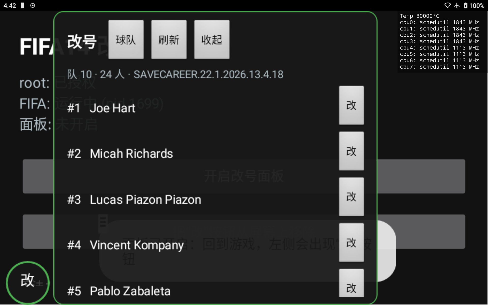

# FIFA14 原版球探全真实球员池 + 生涯改号工具

两个互相独立的部分：

1. **球探真实球员池**：把原版 FIFA14 数据库里 `400000–416281` 的 16,282 个假球员全部替换成真实职业球员（2014–2026 大赛名单 + FIFA15–FC26 评分），并给 1,826 名原版已有球员写入历史最高潜力。配套两个 `fifa.db`，覆盖即用；也附推送脚本。
2. **改号 App**：Android 外置悬浮工具。进入生涯模式后在屏幕上出现一个可隐藏、可整体移除的「改」按钮，选中球员、输入号码，直接修改生涯存档；号码被占用时自动交换。用于解决「新援抢走 2 号」这类引擎选号问题。

> 只在已 root（Magisk）的小米平板 4、Android 8.1、原版 FIFA14（包名 `com.ea.game.fifa14_row`）上实测。其他设备/包名请自行改脚本里的路径。

---

## 一、球探真实球员池

### 文件

| 文件 | 放到平板的哪里 |
|---|---|
| `scout/main_fifa.db` | `Android/data/com.ea.game.fifa14_row/data/cmn/fifa.db` |
| `scout/newdb_fifa.db` | `Android/data/com.ea.game.fifa14_row/data/cmn/New DB/fifa.db` |

实际完整路径（`/sdcard` 即 `/data/media/0`）：

```
/sdcard/Android/data/com.ea.game.fifa14_row/data/cmn/fifa.db
/sdcard/Android/data/com.ea.game.fifa14_row/data/cmn/New DB/fifa.db
```

md5：

```
3a8a4b70420f36e305009f2d02def18c  main_fifa.db   (4,141,714 B)
20492d18892da29e99bce4e8be9b2797  newdb_fifa.db  (4,742,674 B)
```

### 一键推送（推荐）

需要电脑有 `adb`、平板已 root、并已安装原版 FIFA14。

```bash
python tools/push_db.py --adb "C:\path\to\adb.exe"
```

脚本会：停掉 FIFA14 → 把两个库推到 `/data/local/tmp` → 备份平板上原有的两个 `fifa.db`（带时间戳）→ 覆盖 → 按原文件的 uid/gid 与 664 权限修正 → 输出 md5 供核对。

macOS/Linux 也可以直接用 `tools/push_db.sh`。不想用脚本就手动覆盖（注意保持原文件的属主/权限）。

### 注意

- **旧生涯存档与这套库不兼容，必须新建生涯**（pid 与旧档不一致）。旧档请先备份。
- 数据库只包含姓名/生日/国籍/位置/能力/潜力等球员数据，不含任何 OBB/贴图资源。
- `scout/assignment.csv` 是完整 16,282 条名单（pid、板块、姓名、生日、国籍、2026 位置、潜力、donor）。
- `scout/scout_guide.md|csv` 是「按赛季 × 板块」的球探可搜清单（考虑 16 岁出场限制）。
- `scout/FIFA14_球探球员_按年份板块.xlsx` 是同一内容的分年份/分板块总表。
- `scout/ballon_verification.csv` 是 140 名金球奖级球员的逐人核对结果。
- 构建脚本在 `scout/scripts/`（需要本地数据集，路径需自行修改），构建细节见 `scout/SCOUT_BUILD.md` 与 `docs/scout_full_notes.md`。

---

## 二、改号 App

见 [`jersey-app/README.md`](jersey-app/README.md)。APK 在 `jersey-app/apk/jersey-app.apk`。

简要流程：

1. 安装 APK，Magisk 里给 root，允许「显示在其他应用上层」。
2. 打开 App → 「开启改号面板」→ 回到 FIFA14 生涯模式。
3. 屏幕左下角出现「改」按钮；点开 → 显示当前球队名单（按号码排序，含原号码）。
4. 点某球员后面的「改」→ 输入新号码 → 确定。号码被占用会自动与对方交换。
5. 点「收起」面板消失，只剩小按钮；长按小按钮可「移除按钮」或「退出面板」。
6. 改完回到游戏的「读取选项」界面，重新进入生涯即可看到新号码。

存档写入前会自动留一份 `<存档>.bak_jersey`，长按按钮里有「恢复改号前的备份」。




### 可选：进游戏自动出现按钮（Magisk 模块）

安装 `magisk-module/` 后，每次启动 FIFA14 会自动显示「改」按钮，不必先打开本 App。详见 [`magisk-module/README.md`](magisk-module/README.md)，也说明了为什么没有直接改 APK 本体。

---

## 三、目录

```
scout/        球员池数据库、完整名单、球探清单、核对表、构建脚本
jersey-app/   改号 App 源码、构建脚本、已签名 APK
magisk-module/ Magisk 模块：启动 FIFA14 时自动显示改号按钮
tools/        push_db（推送数据库）、verify_md5、patch_career_cpu（可选）
docs/         存档格式说明、球衣号码逆向研究、球探池构建经验
```

## 四、免责声明

仅供个人离线单机使用。请自行拥有正版游戏；修改游戏文件与存档有风险，请先备份。数据库文件是原版游戏数据的修改版，版权归原权利人所有，本仓库仅用于技术交流与个人使用。