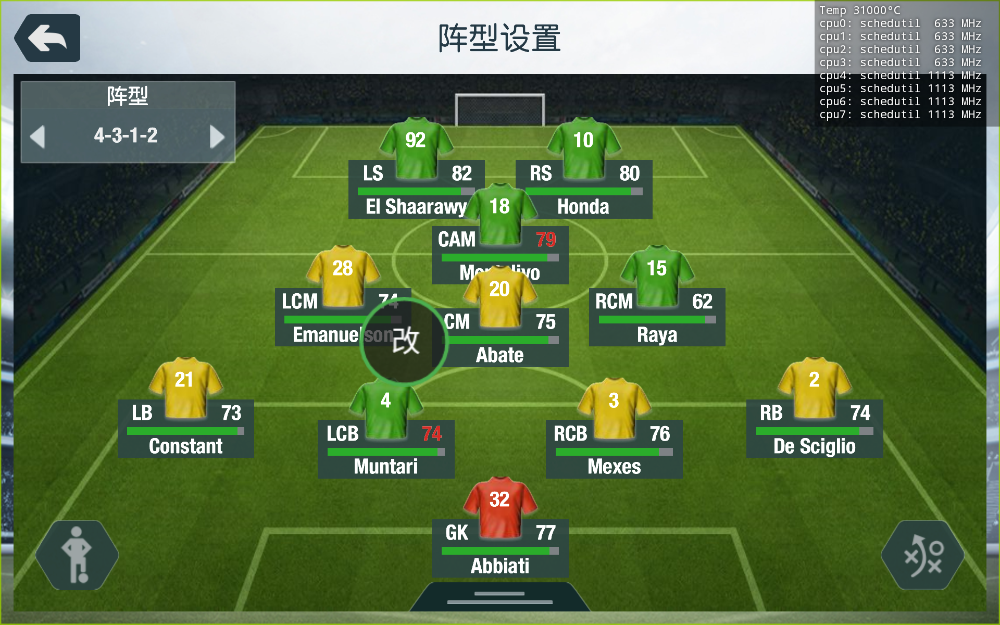
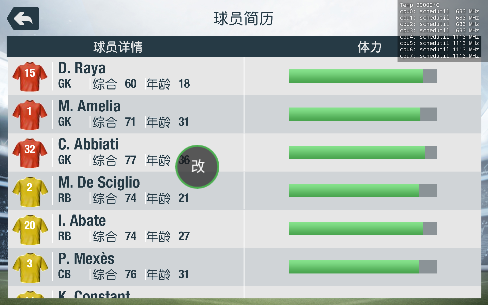
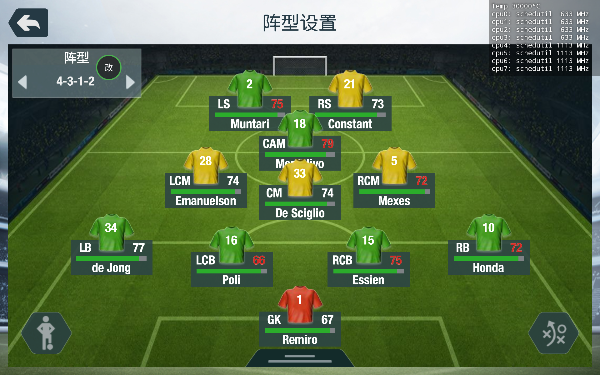
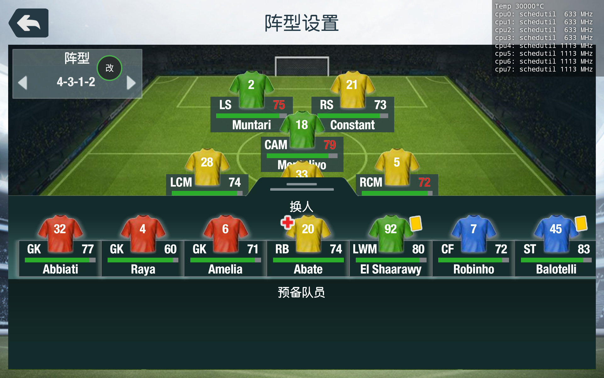

# FIFA14 全流程经验：球探真实球员池 + 生涯改号

> 记录时间：2026-01-25。包含数据库/存档字段、构建与改号程序、踩过的坑和修复过程。
> 目标设备：小米平板 4（Android 8.1）、原版 FIFA14（包名 `com.ea.game.fifa14_row`）、Magisk root。

---

## 0. 一句话现状

- 原版两个库里的 16,282 个假球员已全部替换为真实球员；**位置字段已修正为游戏真正使用的那一个**，主库与 New DB 各 16,282 条位置校验 0 误差。
- 生涯改号 App 可用：悬浮按钮可拖动/可隐藏/可移除，写入存档后**回读校验**，号码交换、CRC 重算、默认定位当前生涯球队、球员/球队模糊搜索均已实现并在游戏内验证。
- 当前两个库 md5：main `a74a7e8acfd93b71068a96d094d8c32f`，New DB `ca6bf1280bd559c6613e581c53269903`。
- 存档已清空；新开生涯会读取新库。

---

## 1. 数据地图

```
游戏 APK            com.ea.game.fifa14_row（不改签名）
OBB                 Android/obb/com.ea.game.fifa14_row/main.*.obb（1.39 GB，BIG4 + RefPack）
可覆盖数据库        /sdcard/Android/data/com.ea.game.fifa14_row/data/cmn/fifa.db          （主库）
                    /sdcard/Android/data/com.ea.game.fifa14_row/data/cmn/New DB/fifa.db    （New DB）
生涯存档            /sdcard/Android/data/com.ea.game.fifa14_row/SAVECAREER.<日>.<月>.<年>.<时>.<分>.<秒>
运行日志            .../files/app_bridge.log（改号 App 写入记录）
```

- 这台原版 FIFA14 **没有 fifaA.db**（fifaA.db 是 FIFA21 mod / 四库结构里的东西）。原版 OBB 里只有两个库：main 3,869,040B、newdb 4,450,032B。
- 数据库也可以直接覆盖在 `data/cmn/`，不需要动 OBB。部署脚本见 `tools/push_db.py`。
- 数据库文件的属主应为 `media_rw:u0_a20245`（uid 1023 / gid 30245），权限 664。

---

## 2. 球员数据库结构

### 2.1 两个库

| 库 | 表数 | 球员表 | 行大小 | 人数 | 队伍 |
|---|---:|---:|---:|---:|---:|
| main（cmn/fifa.db） | 90 | 79 | 72 B | 32,564 | 631 |
| New DB | 123 | 112 | 76 B | 32,565 | 632 |

- 文件头：偏移 12 起是 N 个 u32 表偏移（小端）。
- 球员表：`[count u32][schema ptr u32]` 之后是紧凑行；行数 = (下一张表偏移 − 行区起点) / 行大小。
- `teamplayerlinks` 表（main 是第 80 张，off[80]+8）：16 B/行 `(teamid, playerid, flags, alt)`；球衣号就在 flags 低字节（见 §4）。

### 2.2 行内字段（main 72B / New 76B）

| 字段 | main 偏移 | New 偏移 | 说明 |
|---|---:|---:|---|
| pid | +0 | +0 | u32 |
| 名字指针 1/2/3 | +4/+8/+12 | +4/+8/+12/+16 | 指向文件内字符串；字符串是 `u16 长度 + UTF-8` |
| 生日 | +16 | +20 | u32 打包日期 |
| 位置（游戏实际使用） | **bit175，4 bit，高位在前** | **bit207，4 bit，高位在前** | 见 §2.4 |
| 潜力 | bit374，7 bit | bit406，7 bit | 0-127 |
| 首选/次选位置（旧假设） | bit179/189，各 5 bit | bit211/221，各 5 bit | **不是游戏显示位置的字段**，见 §2.4 |
| 国籍 | bit518，8 bit（高位在前） | bit550，8 bit | 国家码 |
| 属性块 | 20:72 | 24:76 | 52 B，复制 donor 时整块搬走 |

### 2.3 姓名字段与显示名（踩过的坑）

三个名字字段的含义：

- field0 = 名（可能为空）
- field1 = 姓，或“名+姓”的全名（如 `Lucas Piazon`）
- field2 = 短名/昵称（可能为空，如 `Piazon`）

**错误做法**：把三个字段直接拼起来 → `Lucas Piazon Piazon`、`David Silva Silva`、`Pedro Obiang Obiang`。这是索引生成器的问题，不是数据库数据重复。

**正确规则**（`tools/build_player_index.py`）：

```
field0 和 field1 都有 → field0 + " " + field1
只有 field1 → field1
否则 → field0 或 field2
field2 忽略
```

### 2.4 位置字段（本项目最大的坑）

**结论：游戏显示位置读的是 4 bit 字段，main = bit175、New DB = bit207，高位在前（MSB-first）。**

码表（2026-01-25 用游戏内「球员简历」逐人核对得出）：

| 位置 | 码 | 位置 | 码 |
|---|---:|---|---:|
| GK | 0 | CM | 8 |
| RB | 1 | LM | 9 |
| CB | 2 | LW | 10 |
| LB | 3 | CAM | 11 |
| CDM | 5 | RW | 13 |
| RM | 7 | ST | 15 |

兼容映射（用户规则）：`LWB→LB(3)`、`RWB→RB(1)`、`CF→ST(15)`。

**旧假设错在哪**：早期项目把位置写在 bit179/189（main）和 bit211/221（New DB），并回读确认“写入成功”。但游戏根本不读这两个字段，所以：

- 新球员的位置一直**继承 donor**；
- Rodri 看起来正确，只是因为他的 donor 本身就是 CDM；
- Raya 的 donor（pid 205790）是 CM，于是游戏把他显示成 RCM（中场），而不是名单里写的 GK。

**定位方法**（可复用）：用游戏内「球员简历」拿到一批球员的真实位置标签（GK/RB/CB/CM/CDM/CAM/LW/ST…），再在数据库行里穷举 bit 偏移和位宽，找唯一一个能把这些人按位置分成互不相同组的字段。最终唯一命中 bit175/4bit/MSB；New DB 因属性块后移 4 字节，对应 bit207。

**验证**：写入后主库 + New DB 共 16,282 条，位置字段与目标位置 **0 误差**；游戏内 Raya 的球员简历显示 GK。

---

## 3. 球探池构建（morph / donor）

### 3.1 做法

16,282 个假球员槽位（pid 400000–416281）不动 pid，只替换内容：

- 名字：写入新字符串（文件尾追加，指针指过去）；
- 生日、国籍、潜力：写对应字段；
- 属性块 52 B：从一名真实球员（donor）整块复制；
- 位置：写入目标位置（§2.4 的字段）。

### 3.2 donor 选择的坑

旧版按 `donor_pool.csv` 的 `first_pos` 索引 donor，但这份元数据本身不可靠（同一个 donor 的 `first_pos` 与行内位置字段经常不一致）。结果：

- 16,282 个新球员里，donor 实际位置与目标位置**一致只有 6,952 人，9,330 人不一致**；
- 不一致的人，游戏里显示的全是 donor 的位置。

`choose_donor` 旧代码还会在“同位置没有 donor”时回退到宽泛分组，进一步放大错配。

### 3.3 修复后的 donor 规则（用户定义）

- 门将 ↔ 门将
- 中卫 ↔ 中卫
- 边后卫组：LB / RB / LWB / RWB 互通
- 中场组：CM / CDM / CAM 互通
- 边路组：LM / RM / LW / RW 互通
- 前锋组：ST / CF 互通
- 优先同码，其次同组；组内按 `first_ovr` 与目标能力最接近选择。

实现位置：`scout/scripts/build_real_pool.py` 的 `choose_donor()` 与 `ENGINE_CODE`。

### 3.4 重建结果

- 位置字段（bit175 / bit207）与目标位置：**0 误差**；
- 新 md5：main `a74a7e8acfd93b71068a96d094d8c32f`，New DB `ca6bf1280bd559c6613e581c53269903`；
- 副作用：donor 变了，球员当前能力会跟着变（球队评分会变），号码不受影响。

---

## 4. 生涯存档

### 4.1 文件与头

- 文件：`SAVECAREER.<日>.<月>.<年>.<时>.<分>.<秒>`，本档 3,423,800 B。
- **头偏移 0x8 = 当前执教球队 id**（u32 小端）。实测：Milan=47、Man City=10。App 用它做默认球队。
- 头偏移 0x10 = 俱乐部资金（u32 小端），与游戏内显示的金额一致（例：`0x046C9A08 = 74,226,184`）。

### 4.2 roster 行与球衣编码

存档里有一张平坦的球队-球员表，16 B/行：

```
+0  teamid  u32
+4  playerid u32
+8  flags   u32
+12 alt     u32
```

球衣号：

```
jersey = ((flags & 0xFF) >> 1) + 1
flags  = (flags & ~0xFF) | (((jersey - 1) * 2) & 0xFE)
```

改一个号码只动 flags 低字节 1 B；交换两个号码动 2 B。

**对齐坑**：行起点**不是** 16 字节对齐。本档 `offset % 16 == 4`。必须按 0/4/8/12 四种 4 字节对齐各扫一遍，连续 ≥5 行同 team 视为一个球队块。本档得到 587 个块 / 586 支球队；曼城（team 10）在 `0x5AF4`，24 行。

### 4.3 尾部 CRC（游戏拒档的真正原因）

存档最后 4 字节是 **CRC-32**，覆盖 `[0, len-4)`：

- 多项式 `0x04C11DB7`
- **非反射（MSB-first）**
- init `0xFFFFFFFF`
- 最终异或 `0xFFFFFFFF`
- 尾部按小端存放

两份不同的真实存档交叉验证均严格相等。改号码后**必须重算**这 4 字节，否则游戏提示「无游戏存档可用」。

```java
static int checksum(byte[] d, int len) {
    int c = 0xFFFFFFFF;
    for (int i = 0; i < len; i++) {
        c ^= (d[i] & 0xFF) << 24;
        for (int k = 0; k < 8; k++)
            c = (c & 0x80000000) != 0 ? (c << 1) ^ 0x04C11DB7 : c << 1;
    }
    return c ^ 0xFFFFFFFF;
}
```

踩坑：标准反射 CRC32、adler32、md5 前 4 字节都不匹配，早期因此误判“尾部不是校验和”。真正的原因是这是**非反射**变体。

### 4.4 属主/权限与原子写入

正常存档属主：`media_rw (1023) : u0_a20245 (30245)`，权限 `660`。root 直接 `cp` 会变成 `root:root`。

写入流程（`SaveBackend.write`）：

1. 读原文件 `stat` 拿 uid/gid/mode；
2. 写临时文件 → `chown`/`chmod` **临时文件**；
3. `mv -f` 原子替换；
4. **回读整个文件逐字节比对**，不一致就报错；同时校验 CRC。

注意：`chown` 必须在 `mv` 之前作用于临时文件；先 `mv` 再 `chown` 会留下错误属主的窗口。

### 4.5 写入时机（2026-10-25 实测更新）

- 正确时机：游戏停在生涯「读取选项」界面时改，然后进入生涯。
- **已经进生涯了也能改，但必须强退游戏**：正常退出（回主菜单 → 退游戏）时游戏会用自己的内存状态重写存档，把改动覆盖掉。实测：球探签到 Raya 给 6 号 → App 里与 1 号 Amelia 交换，提示保存成功 → 正常退出再进，Raya 仍是 6 号。改为 `am force-stop com.ea.game.fifa14_row` 强退后，改动保留。
- 因此 App 的流程改成：**先连续改完所有号码（pending 计数），改完再一次性强退**，而不是每改一个就杀一次游戏。
- 强退要走「用户同意」：弹出确认框说明“改号已写入并校验（本次 N 处），强退会丢未保存的比赛进度，但号码保留”。用户点确定后才 `force-stop`。**不许无提示闪退**（用户明确要求）。
- 旧版 App 的失败根因之一：写入只检查属主、不回读内容，失败也提示“已交换”，列表还显示内存里的假结果。现在 `apply()` 只在**回读校验通过**后才刷新列表并 `pending++`。

**补充（2026-10-26 实测，别把“退出会重写”理解反了）**：

“退出时重写存档”本身不是坏事——游戏重写的是它**内存里的名单**。只要它是**从已经改过的存档**进的生涯，内存里就是新号码，退出重写后依然是新号码。实测：冷启动 → 进生涯看到 33/2/1 → 正常退出（回主菜单，游戏自己“保存中…”）→ 把档拉回来，`#4 Raya / #33 De Sciglio / #2 Muntari` 全对，CRC 也自洽。

真正会覆盖改动的场景只有一个：**改号时游戏正开着生涯，而它的内存还是改之前的旧名单**。所以才需要“改完强退、冷启动”。

### 4.6 操作日志

App 内 `Log` 类把每一步都写到 `Android/data/com.zcode.jersey/files/jersey.log`（单文件滚动），包括：

- 用户动作：点按钮、选球队/球员、输入号码、取消、确认强退；
- 内部动作：发现的存档路径、球队头、每行 offset、旧号码→新号码、CRC 计算、临时文件属主/权限、回读比对结果、`force-stop` 返回值。

排查时先看这个日志，不要靠猜。游戏内的小字用 OCR 读经常出错（曾把 `#1` 读成 `#15`），日志才是准的。

---

## 5. 改号 App（com.zcode.jersey）

### 5.1 架构

- `PanelService`：前台服务 + 悬浮窗（`TYPE_APPLICATION_OVERLAY`，API<26 用 `TYPE_PHONE`）。
- `SaveBackend`：root 读写存档、发现球队块、改/换号码、CRC、回读校验、自动备份。
- `PlayerIndex`：读随包 `assets/fifa.db` 索引（pid→姓名、球队→名单）。
- `MainActivity`：状态与开启/移除。

### 5.2 悬浮按钮

- 默认位置 `(6dp, 300dp)` 附近；**可全屏拖动**，位置存 SharedPreferences。
- 拖动边界用 `getLocationOnScreen()` + `Display.getSize()` 在**真实屏幕坐标**里限制，再换算回窗口坐标；不用固定分辨率。
- **触摸只认圆内**：Button 的测量框比画出来的圆大，圆外点击必须透传给游戏。实现：DOWN 时判断触点与圆心距离，超出 `min(w,h)/2` 直接返回 false。
- 长按 650ms 弹菜单（服务里不能用 `OnLongClickListener` 来判定，因为自定义 OnTouchListener 吃掉了事件，需要自己 postDelayed）。
- 面板「收起」只移除面板窗口；长按菜单可「移除按钮」「恢复改号前的备份」「退出面板」。

### 5.2.1 必须声明 targetSdk（旧版画布坑，2026-10-26）

**症状**：面板整体小得离谱、文字挤在一起、底部「完成并强退游戏」按钮直接跑到屏幕外点不到；改用「按实际测量高度重新摆放」也救不回来。

**原因**：`AndroidManifest.xml` 里没有 `<uses-sdk>`，系统按 `targetSdkVersion=1` 处理，应用被放进**旧版屏幕兼容模式**：拿到一块 512×320、density=1.0 的虚拟画布，再整体放大到 1920×1200（约 3.75 倍）。于是所有 `dp()` 值都被缩小 3.75 倍，窗口自己以为只有 512×320 高，怎么算都装不下。

**修法**（两处都要）：

```xml
<uses-sdk android:minSdkVersion="23" android:targetSdkVersion="28" />
<supports-screens android:smallScreens="true" android:normalScreens="true"
                  android:largeScreens="true" android:xlargeScreens="true"
                  android:anyDensity="true" android:resizeable="true" />
```

`anyDensity="true"` 单独写不够，必须配 `uses-sdk`；只写 `uses-sdk` 也会在部分机型上仍按兼容模式起。

**自查**：`adb shell dumpsys window | grep -i "com.zcode.jersey"` 里窗口尺寸若是 512×320（而不是 1920×1200），就是命中了这个坑。

### 5.2.2 拉起服务的命令（targetSdk 28 之后）

`targetSdk` 提到 28 后，服务受后台启动限制，`am startservice` 会被静默拒绝（返回 `START_NOT_STICKY` 但服务根本没起）。必须：

```bash
adb shell su -c "am start-foreground-service -n com.zcode.jersey/.PanelService -a com.zcode.jersey.SHOW"
adb shell su -c "am start-foreground-service -n com.zcode.jersey/.PanelService -a com.zcode.jersey.HIDE"
```

Magisk 开机自启模块 `fifa14_jersey_auto` 里的脚本同样要改成 `start-foreground-service`，否则升级 APK 后按钮会“消失”。

### 5.3 弹窗的坑

服务上下文**不能**用 `AlertDialog`（`BadTokenException: token null is not valid`）。所有弹窗都是 `WindowManager.addView` 的 overlay：

- 号码输入弹窗置顶 `y=56dp`，否则数字键盘会挡住「确定」；
- `softInputMode = SOFT_INPUT_STATE_ALWAYS_VISIBLE` 才自动弹键盘。

### 5.4 球队与球员

- 默认球队：读存档头 `0x8` 的球队 id（Milan=47 / Man City=10 两档验证），没有再用“最大名单块”兜底。
- 球队搜索：忽略词序与词首（`AC Milan` / `Milan AC` / `milan` 都能命中）。
- 球员搜索：全存档模糊搜索，空格分词、忽略顺序，结果显示 `#号码 姓名 · 球队`。
- 列表按号码排序；号码被占用自动交换。

**搜索框语义（用户反复纠正过，别再搞错）**：

> 不是“选中之后清空搜索框”，而是“没经过搜索的，不要把名字填进搜索框”。

- 搜索框**只显示用户自己敲进去的字**。
- 没有搜索时直接点球员的「改」：搜索框保持原样（空就是空，有字就保留）。
- 用搜索结果选中球员：搜索框保留用户敲的关键词，不清空、不换成球员名。
- 选球队：**不往搜索框写任何东西**，也不清空。
- 反面教材：之前实现成“选中后清空”，语义完全不同，被用户否掉。

### 5.4.1 批量改号与退出

- 每改一处 `pending++`，按钮文案变成「完成并强退游戏（已改 N 处）」。
- 点它 → 确认弹窗（见 §4.5）→ `am force-stop` + 回显 `KILLED`。
- `pending == 0` 时不显示强退按钮，避免用户误以为有改动待生效。

### 5.5 名称索引的坑

- `assets/fifa.db` 是自定义索引：`u32 magic 0x4A523034` + 球员表 + 球队表。
- **文件是小端**，而 Java `DataInputStream.readInt()` 是大端 → 直接读会报 `bad index magic`。必须手写 LE 读取。
- 索引生成器早期把三个姓名字段直接拼接，产生 `Piazon Piazon`；已按 §2.3 规则重建（18,375 个名字被更正）。

### 5.6 构建（无 Gradle）

`jersey-app/build_apk.py`：

1. `aapt2 compile/link`（`-A assets`）；
2. `javac --release 8`；
3. `d8 --min-api 23`；
4. 把 `classes.dex` 加进 res.apk；
5. `zipalign -p 4`；
6. `apksigner`（自签名 keystore，**不入库**）。

---

## 6. 为什么没有直接改 APK 本体

1. **签名**：Android 只允许同签名覆盖安装。改 `base.apk` 必须重签 → 必须卸载原游戏 → 会删除 `Android/data`（存档）和 1.4 GB OBB，风险远大于收益。
2. **UI 没有扩展点**：FIFA14 界面是 EA 私有的 Apt 编译脚本，没有公开编译器，无法在球员界面加按钮。
3. **原生改法**：要 patch `libFIFA14.so` 的转会选号逻辑，需先定位选号函数（目前只到 `MGRSetPlayerJerseyNumber` 的 setter），且 patch 后的 `.so` 仍受签名限制，只能 Zygisk 注入。

**替代方案（已实现）**：Magisk 模块 `fifa14_jersey_auto` —— 每次 FIFA14 启动时用 root `am startservice -a com.zcode.jersey.START` 静默拉起悬浮按钮（只显示按钮，不展开面板）；用户手动退出面板后不会自动复活，直到下次启动游戏。

---

## 7. 验证方法与事故复盘

### 7.1 正确的验证方式

1. 文件层：拉回存档，比对字节 diff、CRC、属主/权限；
2. **目标程序内**：进游戏看实际显示（阵型界面号码、球员简历位置）；
3. 两步都过才算“可用”。

**adb 坐标与截图的对应关系（2026-10-26 实测）**：

- `screencap` 出来是 1920×1200（横屏），`input tap x y` 和 `uiautomator dump` 的 `bounds` 用的都是**同一个 1920×1200 空间**，1:1，不需要任何缩放系数。以前文档里写的“约 1.6 倍”是看图的缩放错觉，已作废。
- 看图时若被查看器缩小（例如显示成 1440 宽），点击坐标要按 `1920/1440≈1.333` 乘回去。
- 拿不准就 `uiautomator dump` 取 `bounds` 中心，比肉眼估更稳。

**拉存档不要用 `exec-out cat`**：Git Bash 下 shell 的 cwd 会被重置，重定向会把文件写坏/截断（实测只拿到 94 字节）。一律先在设备内 `cp` 到 `/data/local/tmp/`，再 `MSYS_NO_PATHCONV=1 adb pull`。

### 7.2 犯过的错（必须记住）

1. **只验证文件层就宣称成功**：第一次改号（Richards↔Sturridge）字节 diff 正确、CRC 也对，但没进游戏验证，实际被拒档（当时漏了 CRC，后来补上；但流程错误在先）。
2. **把属主当成拒档主因**：属主确实应该保持，但拒档的直接原因是 CRC；先修属主并不能解决问题。
3. **位置字段判断错误**：一直以为 bit179/189 是游戏使用的位置字段，写进去、回读也对，但游戏不读；直到用户实测“Raya 是中场”才发现。定位方法见 §2.4。
4. **“站位槽”狡辩**：阵型图上的 RCM 是站位槽，但球员简历明确写 RCM/GK，说明游戏数据确实把 Raya 当成了中场。不能用“只是站位”解释。
5. **把 A 当 B**：用户说的是 RCM，我反复说 CM，沟通上应先对齐“游戏里显示的原话”。
6. **截图/坐标**：悬浮窗在旋转屏幕下的坐标与 `lp` 不是简单线性关系；拖动边界要用 `getLocationOnScreen`，不要用 `getResources().getDisplayMetrics()`（服务进程可能停留在旧方向）。
7. **`am startservice` 以 shell 调用会被 `exported=false` 拒绝**，root（`su -c am ...`）可以。
8. **游戏启动时的 `false/false` 弹窗**：EA 在线检查失败的提示，与改号无关；用 BACK 键可关掉，点「确定」偶尔会被悬浮按钮挡住（已用圆形触摸修复）。
9. **写盘时游戏正在生涯里**：退出时游戏会重写存档，覆盖改动；要在「读取选项」界面改。
10. **索引大小端**：`DataInputStream` 是大端，自定义小端索引必须手写读取。

### 7.3 证据

- 改号后游戏内阵型界面：Raya 15 号、Mexès 3 号。

  

- 位置修复后球员简历：Raya 显示 GK（门将红色球衣）。

  
- 存档 CRC 两份真实存档交叉验证；16,282 条位置 0 误差。

### 7.4 改号全链路验收记录（2026-10-26，含“重启游戏后仍生效”）

这次是**完整走一遍用户真实路径**自测的，不是只看文件：

1. 用改号 App 把 Muntari 改回 **2**、De Sciglio 改 **33**、Raya 改 **4**、Remiro 改 **1**，点「完成并强退游戏」→ App 弹确认 → `am force-stop`。
2. 冷启动游戏：主界面 → 进行游戏 → 经理模式 → 读取选项 → 继续职业生涯（约 45 秒）。
3. 阵型设置 → 球队管理 → 「受伤与受罚停赛的场上球员被自动替换！」确认。
4. 阵型图为游戏自己渲染的结果：**CM 33 De Sciglio**、**LS 2 Muntari**、**GK 1 Remiro**。

   

5. 点阵型图下方那条横杠，展开「换人 / 预备队员」，替补席显示 **GK 4 Raya**（另有 32 Abbiati、6 Amelia）。

   

6. **退出游戏**（BACK → 阵型设置 hub → 「您确定要退出吗？」→ 是的 → 回主菜单），游戏自动重写存档；把重写后的存档拉回来：
   - `md5 39afa8e0…`，CRC `calc=f4ade652 stored=f4ade652 ok=True`（游戏自己写的档，CRC 自然是对的）；
   - 号码全部保持：Raya **#4**、De Sciglio **#33**、Muntari **#2**、Remiro **#1**、Amelia **#6**、Abbiati **#32**。
7. 结论：**改号 → 强退 → 冷启动 → 游戏内显示 → 正常退出 → 存档里仍然正确**，全链路闭合。

> 关键前提：改的时候游戏**不能正在生涯里**（否则内存里的旧名单会在退出时覆盖存档，见 §4.5）。所以 App 才做「完成并强退游戏」+ 用户确认 + `force-stop`。

---

## 8. 工具与命令

```bash
# 部署数据库（自动备份、修属主/权限）
python tools/push_db.py --adb adb

# 安装改号 App
python tools/install_app.py --adb adb

# 安装 Magisk 自动悬浮模块
python tools/install_module.py --adb adb --start-now

# 校验两个库的 md5
python tools/verify_md5.py

# 从 cmn/fifa.db 重建 App 名称索引
python tools/build_player_index.py --db scout/main_fifa.db --asset jersey-app/src/assets/fifa.db

# 可选：改 OBB 内 [CAREER] 的 CPU 转会参数
python tools/patch_career_cpu.py <原版obb> <输出obb>
```

### 存档操作常用片段

```bash
# 拉取最新存档
adb shell su -c 'cp /sdcard/Android/data/com.ea.game.fifa14_row/SAVECAREER.* /data/local/tmp/s.bin'
adb pull /data/local/tmp/s.bin
# 写回：chown 1023:30245 / chmod 660，并重算尾部 CRC
```

---

## 9. 版本与文件

| 文件 | md5 |
|---|---|
| scout/main_fifa.db | `a74a7e8acfd93b71068a96d094d8c32f` |
| scout/newdb_fifa.db | `ca6bf1280bd559c6613e581c53269903` |
| 原版 OBB（1,386,236,976 B） | `4207c3ce8b1ca6b7793d7e5de432207f` |
| 调过 CPU 转会参数的 OBB（同尺寸） | `2eea673ac58cdb1fb35c60ecba74dfa3` |
| jersey-app APK | 见 `jersey-app/apk/`，源码见 `jersey-app/src/` |

- 位置码表、donor 规则、CRC 算法、存档布局都以本文为准。
- 旧的“位置写 bit179/189”“尾部不是校验和”等结论**已作废**。

---

## 10. 仍待确认/风险

- 位置码 4/6/12/14 的精确含义未全部确认（当前用 LWB→LB、RWB→RB、CF→ST 兼容映射；目标位置码集已覆盖全部 16,282 人）。
- 重建 donor 会改变球员当前能力，旧生涯的球队评分会变化；如需保留旧能力，需要另做“只改位置、不换 donor”的版本。
- 改号 App 只实测过 `com.ea.game.fifa14_row`；其他包名需改 `SaveBackend.DIR`。
- 游戏本体未改（签名/UI/native 三条路的风险见 §6）。
---

## 11. OBB 内置转会参数（`[CAREER]` 段）

### 11.1 位置与写法

- 段起点：OBB 内偏移 `924406512`，长度 `40000` 字节，开头就有 `[CAREER]` 标记。
- 全文是文本 INI：`KEY = VALUE`，共 **710** 个键值行。
- 改法**必须等长**：数值用空格右补齐（`3` → `12` 会把 1 字节撑成 2 字节，需用整行替换 `MAX_PER_TEAM_BUYS = 3` → `MAX_PER_TEAM_BUYS =12`）。只要字节数不变，OBB 布局就不移位，游戏不校验这一段的 md5。

### 11.2 参数是否生效，先看在不在 `libFIFA14.so` 里

`libFIFA14.so`（18,187,340 B）里**字符串存在才会被读**。实测：

| 键 | 在 .so 中 |
|---|---|
| `PROB_BUYING_PLAYER` / `SIGNING_CHANCE` / `SMALL_TEAM_SIGNING_CHANCE` | ✓ |
| `PROB_CPU_OFFER` / `PROB_CPU_APPROACH` / `CHANCE_OF_BOSMAN` | ✓ |
| `CPU_*_BUY_PRICE_RANGE` / `WAGE_OFFER_DIVIDER` / `RATING_DIFF_FOR_CPU_SCOUT` | ✓ |
| `MAX_PER_TEAM_BUYS` / `MAX_PER_TEAM_SALES` / `PROB_SELLING_RANDOM_PLAYER` | ✓ |
| `MAX_PLAYERS` / `IDEAL_NUM_PLAYERS` / `STAR_INTEREST_THRESHOLD` / `TRANSFER_PLAYER_DIF_BUY_MULT` | ✓ |
| **`BUYING_PLAYER_RATING_DIF`** | ✗ 不在 .so，改了也无效 |
| **`PROB_BUY_FIRST_PLAYER`** | ✗ 不在 .so，改了也无效 |

所以 `patch_career_cpu.py` 里这两个键已删除，只保留能生效的。

### 11.3 “报价被嫌弃”的教训（2026-10-25）

现象：身价 1700 万的未挂牌球员，报 2400 万，满意率只有 50%。

原因：早期把**卖方意愿**类参数一起调高了——

| 键 | 原版 | 当时的错误值 | 作用 |
|---|---|---|---|
| `IDEAL_NUM_PLAYERS` | 23 | 28 | CPU 认为理想阵容人数 |
| `MAX_PLAYERS` | 30 | 40 | CPU 阵容上限 |
| `STAR_INTEREST_THRESHOLD` | 70 | 55 | 多高的球员才值得买 |
| `TRANSFER_PLAYER_DIF_BUY_MULT` | 0.75 | 1.00 | 报价与身价差的倍率 |

阵容上限和理想人数一涨，每个 CPU 俱乐部都“还想多留人”，于是对非挂牌球员开出天价溢价。

**修正后的 patch 只保留 CPU 活跃度**（买方更积极、更容易签约、更多报价），这四个键回到原版：

```
IDEAL_NUM_PLAYERS = 23      MAX_PLAYERS = 30
STAR_INTEREST_THRESHOLD = 70   TRANSFER_PLAYER_DIF_BUY_MULT = 0.75
```

修正版相对原版共改 **16 个键 / 17 行**（`WAGE_OFFER_DIVIDER` 出现两次）；相对“之前装到平板的错误版”只回退 6 个键（上表 4 个 + 两个 .so 里不存在的空转键）。已用脚本断言：710 行数量一致、原版→修正版的改动集合与预期完全相等、回退值全部等于原版。

### 11.4 校验方法

```bash
# 直接抠出段的 40000 字节，逐键对比，不看 md5 猜
python - <<'PY'
import re
START, LEN = 924406512, 40000
def sect(p):
    with open(p,'rb') as f: f.seek(START); return f.read(LEN)
pat = re.compile(rb"(?m)^(\s*([A-Z0-9_]+)\s*=\s*)([0-9.]+)")
kv = lambda b: [(m.group(2).decode(), m.group(3).decode()) for m in pat.finditer(b)]
ORIG = 'D:/FIFA14/work/obb_original.bin'
PATCHED = 'D:/FIFA14/modified_copy_20261025/main.136.com.ea.game.fifa14_row.obb'
a, b = kv(sect(ORIG)), kv(sect(PATCHED))
print([(x, y) for x, y in zip(a, b) if x != y])
PY
```

注意：`WAGE_OFFER_DIVIDER` 在段内出现**两次**（值分别 10 和 15），两次都要改，脚本用 `finditer` 全匹配。

### 11.5 换 OBB 的操作与验证

1. 用 `tools/push_obb.py` 换（会自动强停游戏、在设备内留一份备份、按原本的 `10245:1015 / 660` 写回并回读 md5）：
   ```bash
   python tools/push_obb.py --adb adb --serial 89e96829 \
       --obb "D:/FIFA14/modified_copy_20261025/main.136.com.ea.game.fifa14_row.obb"
   ```
2. **由用户自己启动游戏**（不要从脚本里拉起来）。
3. 验证报价：找同一个“未挂牌”球员，报“身价 + 40%”左右，看满意率是否回到接近 100%。
4. 若旧生涯里仍只有 50%，说明这些参数在**生涯创建时**就被读进内存了——换一个新建生涯再验一次，不要据此判定 patch 无效。

> 推 OBB 前先问用户；OBB 1.4 GB，替换期间不能有进程映射它。
